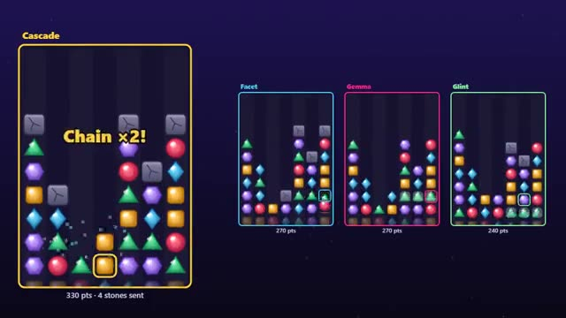

# Match-3 Duel

Match gems, chain combos, bury rivals in stone. A multiplayer starter game from [Multiplayer Agent](https://multiplayeragent.com): 2D, versus, 2–4 players, with bots that fill empty seats.

## How it plays

Swap gems to line up 3 or more while your stack rises from below. Chains and big matches drop stones on a rival; a board that fills to the top is out. Last board standing wins.

**Controls:** Drag a gem onto a neighbor (or click two), arrows + Space work too; on touch, drag a gem.

## Make it yours in the Game Builder

Open the [Game Builder](https://multiplayeragent.com), choose **Start from a starter game** and pick Match-3 Duel. It opens as version 1 in your studio, ready to play and publish. Then ask for changes, for example:

- Add a bomb gem that clears its whole row
- Make it a 2-minute high-score race instead
- Turn the gems into candy with a candy-shop look

## Run it yourself

1. Get a free publishable key (`pk_…`) at [multiplayeragent.com](https://multiplayeragent.com).
2. In `index.html`, put it in place of `pk_REPLACE_ME` in the `MP_CONNECT` block.
3. Open `index.html` in a browser. No build step and no server needed.

Without a key it still runs, offline against bots.

## How it is built

- One `index.html`. The comment at the top of the script maps the code and explains the multiplayer.
- Every gem, stone and effect is drawn in code on a canvas; there are no image files.
- **Live sync:** Every rival's board plays out next to yours, gem by gem.
- **Host-run rounds:** The host's browser runs the match: who is out, the winner and the restart. If it leaves, the next player takes over.
- **Bots:** Bots fill empty seats: they look for chains and send stones like a decent player.
- **Leaderboard:** Each player's best score in one match.
- `?attract` runs it offline with bots only. The preview video is recorded from it.

## License

MIT.
